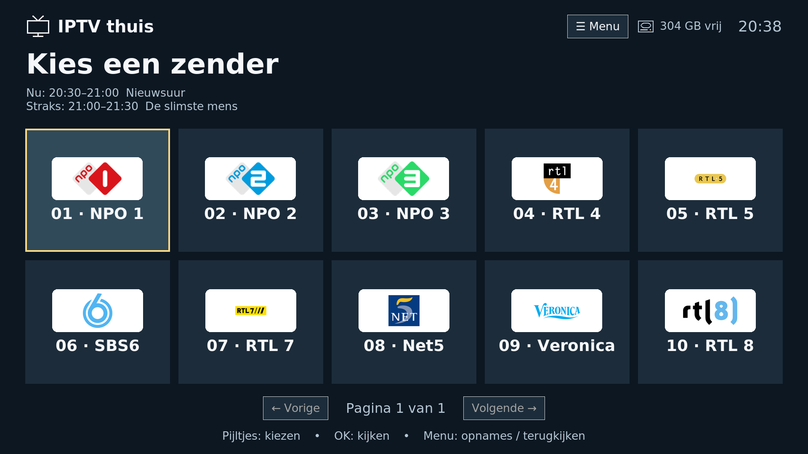
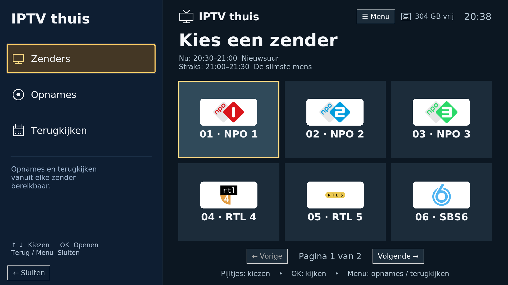
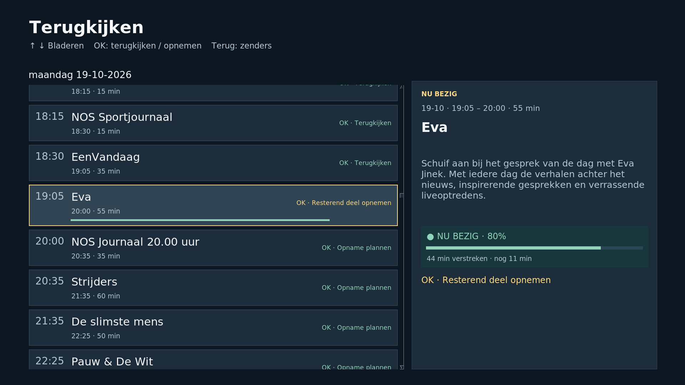
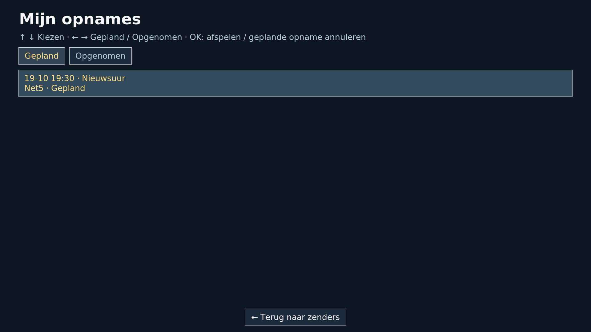
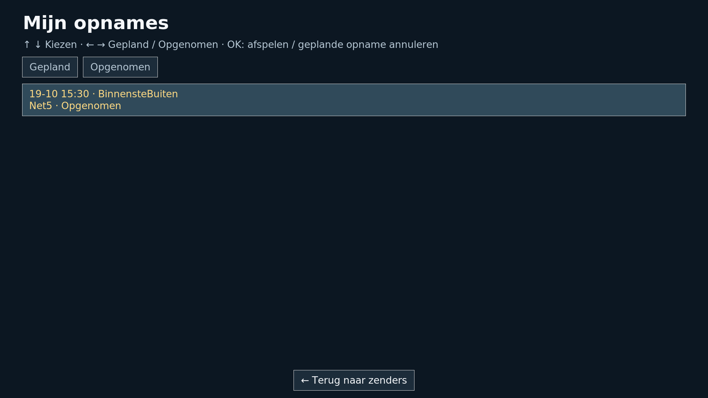
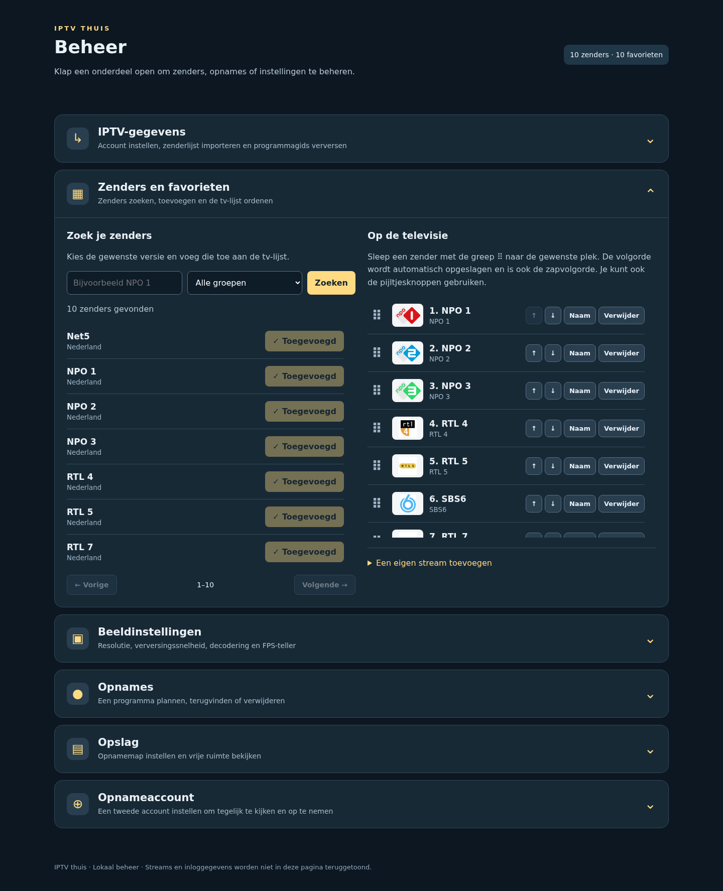
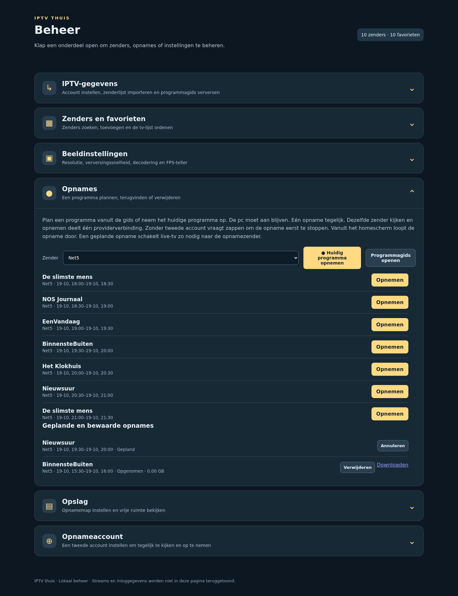
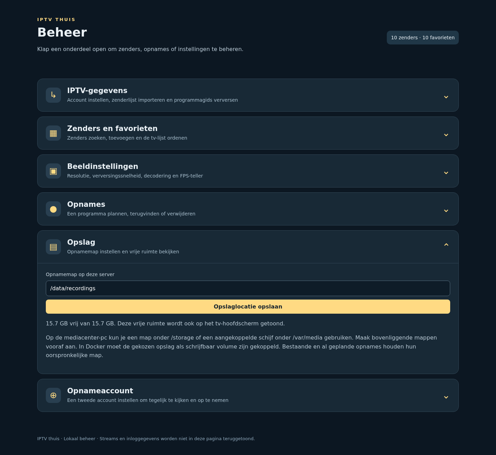

# IPTV thuis

Een zelfstandige Linux-tv-app met grote zenderknoppen en een aparte webbeheerpagina. Ontworpen voor iemand die alleen wil kiezen, kijken en zappen, zonder Kodi-menu's.

De app draait zelfstandig met Tk en mpv onder X11. Voor Debian/Ubuntu is een Linux-installatiescript beschikbaar; voor LibreELEC Generic x86_64 is er een aparte [tv-container met Xorg en mpv](deploy/libreelec/README.md). De LibreELEC-versie is getest met HDMI-beeld en -geluid, een USB-afstandsbediening, EPG en opnames. De reguliere Docker-container biedt webbeheer en een browserpreview; live afspelen gebeurt in de zelfstandige tv-app.

## Inhoud

- [Screenshots](#screenshots)
- [Functies](#functies)
- [Installatie](#installatie)
- [Afstandsbediening](#afstandsbediening)
- [Beheer en gegevens](#beheer-en-gegevens)
- [IPTV met losse inloggegevens](#iptv-met-losse-inloggegevens)
- [HDMI-geluid op LibreELEC](#hdmi-geluid-op-libreelec)
- [Beeldinstellingen](#beeldinstellingen)
- [Programmagids](#programmagids-epg)
- [Terugkijken op de tv](#terugkijken-op-de-tv)
- [YouTube cast vanaf je telefoon](#youtube-cast-vanaf-je-telefoon)
- [Backupaccount voor live-tv](#backupaccount-voor-live-tv)
- [Opnemen en opslag](#opnemen-met-de-programmagids)
- [Importgedrag](#importgedrag)
- [Streambewaking en diagnose](#streambewaking-en-diagnose)
- [Automatisch wisselen tussen zenderbronnen](#automatisch-wisselen-tussen-zenderbronnen)
- [Browserontwerpen](#browserontwerpen)
- [Ontwikkelen en testen](#ontwikkelen-en-testen)
- [Project delen](#project-delen)

## Screenshots

De screenshots tonen de tv-app en het webbeheer. De tv-beelden zijn opnieuw gemaakt met de huidige native app op 1920×1080; de beheerbeelden tonen de huidige webinterface. De programma’s en opnames zijn voorbeeldgegevens. Het hoofdscherm, zijmenu en webbeheer tonen echte zenderlogo’s uit de appcache; bij ontbrekende logo's blijft de zendernaam zichtbaar. Er staan geen provider-inloggegevens of persoonlijke beheerinstellingen in beeld.

### Televisie

Grote favorietenknoppen, de huidige en volgende uitzending en de vrije ruimte op de ingestelde opnameschijf.



### Zijmenu

Open met Menu vanuit elke zender. Het zijmenu heeft pictogrammen en een afgeronde, goudgele selectie voor Zenders, Opnames en Terugkijken. **Links** of **Terug** sluit het menu en bewaart de geselecteerde zender.



### Terugkijken en opnemen

Eerdere, lopende en toekomstige uitzendingen staan in één doorlopende lijst voor de geselecteerde zender. Rechts staan de programmabeschrijving, de voortgang van een lopende uitzending en de actie voor OK.



### Opnames terugkijken

Met links/rechts wissel je tussen **Gepland** en **Opgenomen**. OK annuleert een plan of speelt een bewaard bestand af.





### Zenders beheren

Zoek zenders, pas namen aan en sleep favorieten naar de gewenste volgorde.



### Opnames beheren

Plan via de EPG en beheer bewaarde opnames.



### Opslag instellen

Kies de map voor nieuwe opnames en controleer de vrije ruimte.



## Functies

- Maximaal tien grote favorieten per pagina; meer pagina's verschijnen automatisch.
- EPG met huidige en volgende uitzending, plus **Terugkijken** met providerarchief, programmabeschrijvingen en opnameplanning.
- Eén OK-knop: een afgelopen uitzending terugkijken, het resterende deel van een lopend programma opnemen of een toekomstige opname plannen. Een aparte opnameknop is niet nodig.
- Tijdens live-tv verschijnt tien minuten voor het volgende EPG-programma rechtsboven een melding met zender, titel en begintijd. De melding verdwijnt na twaalf seconden en verschijnt eenmaal per programma; zonder EPG of tijdens opnames verschijnt ze niet.
- Opnames terugkijken op de tv; opslaglocatie, planning en bestanden beheren via de webpagina.
- Vrije ruimte van de ingestelde opnameschijf zichtbaar op het hoofdscherm.
- Streams spelen met mpv binnen hetzelfde venster.
- Pijltjes of CH+/CH− zappen direct door de favorieten tijdens de uitzending. Na de laatste volgt de eerste.
- Terug opent de zenderlijst. OK tijdens het kijken toont kort de zendernaam en de huidige en volgende uitzending, plus vier seconden de actuele tijd rechtsboven.
- Webbeheer op `http://IP-VAN-TV-PC:8080/admin`: Losse Xtream Codes-inloggegevens gebruiken, M3U uploaden of via een adres ophalen, zoeken, groepen filteren, favorieten toevoegen, verwijderen, hernoemen en ordenen door te slepen, eigen stream toevoegen.
- Een opgeslagen M3U-adres wordt elke zes uur vernieuwd zolang de app draait. De app controleert elke minuut of verversen nodig is; bij een fout probeert hij het na vijftien minuten opnieuw. Bij starten wordt alleen opnieuw opgehaald als de laatst geslaagde import minstens zes uur oud is. Een bestandsupload vervang je door opnieuw te uploaden.
- Een automatische verversing die meer dan de helft van de bekende favorieten laat verdwijnen wordt geweigerd, ook wanneer de provider nog een grote lijst films en series terugstuurt. De vorige catalogus en streamadressen blijven behouden en de app probeert het na vijftien minuten opnieuw.
- Eigen namen en volgorde blijven bewaard bij import. Verdwenen zenders blijven als niet beschikbaar zichtbaar en worden bij zappen overgeslagen.
- Bij ontbrekende programmagids-ID’s bewaart de app bekende favorieten en alternatieve bronnen door zenders binnen dezelfde groep op naam te koppelen. Een gewijzigde kwaliteitsvermelding zoals FHD naar HD mag daarbij verschillen. Dubbelzinnige namen of afwijkende programmagids-ID’s worden niet automatisch gekoppeld; opgeslagen voorkeursbronnen blijven behouden.
- Standaard uitgebreide M3U-lijsten met `#EXTINF`, HTTP(S), RTSP, RTMP en UDP. Kodi-stijl HTTP-headers na `|` worden doorgegeven aan mpv. Terugkijken ondersteunt het Xtream Codes-providerarchief wanneer het abonnement en de zender dit aanbieden. DRM, andere catch-upformaten en aanbieder-specifieke loginflows worden niet ondersteund.

## Installatie

Kies de installatie die bij je apparaat hoort:

| Omgeving | Installatie | Video afspelen |
| --- | --- | --- |
| LibreELEC Generic x86_64 | [Tv-container met eigen Xorg](deploy/libreelec/README.md) | Native tv-app met mpv via HDMI |
| Debian/Ubuntu met X11-desktop | Onderstaand Linux-installatiescript | Native tv-app met mpv |
| Docker op een ontwikkelcomputer of server | Onderstaande Compose-configuratie | Webbeheer en browserpreview |

### Webbeheer en browserpreview met Docker

```sh
docker compose up -d --build --wait
docker compose exec app cat /data/first-login.txt
```

Open `http://IP-VAN-DOCKER-HOST:8090/admin` en log in als `admin` met het wachtwoord uit de tweede opdracht. Vul je serveradres, IPTV-gebruikersnaam en IPTV-wachtwoord in en klik op **Inloggen en zenders ophalen**, of importeer je M3U. Voeg favorieten toe en open `http://IP-VAN-DOCKER-HOST:8090/tv` om de zenderknoppen, pagina's en direct zappen te testen. Deze browser-preview gebruikt je echte favorieten en haalt wijzigingen elke vijf seconden op, maar speelt **geen live video** af. Echte mpv-weergave blijft onderdeel van de Linux-desktop-app.

De container draait zonder root, met een alleen-lezen app en een blijvend Docker-volume voor de database en beheerconfiguratie. Herstarten of opnieuw bouwen bewaart je gegevens. `docker compose down` stopt de app; voeg geen `--volumes` toe als je de gegevens wilt bewaren. Wijzig de poort desgewenst met `IPTV_PORT=8091 docker compose up -d`. Alleen op de Docker-host bereikbaar maken kan met `IPTV_BIND_ADDRESS=127.0.0.1 docker compose up -d`.

Een Docker-beheerwachtwoord wijzigen: `docker compose stop app`, daarna `docker compose run --rm --service-ports app python -m mijntv --admin-only --data-dir /data --reset-password`. Stop deze tijdelijke instantie na de wijziging met Ctrl+C en start de normale instantie weer met `docker compose up -d`.

### Zelfstandige tv-app

Gebruik Debian/Ubuntu met een lichte desktop, bijvoorbeeld XFCE, en een **X11/Xorg-sessie**. De speler wordt ingebed met een X11-venster-ID; native Wayland is niet het ondersteunde pad. Zie de [mpv-documentatie](https://mpv.io/manual/stable/#options-wid).

```sh
git clone https://github.com/MrHymanz/IPTV-thuis.git
cd IPTV-thuis
sh tools/install-linux.sh
~/.local/bin/iptv-thuis
```

Het script installeert Python, Tk, Pillow, mpv en lettertypen met sudo, kopieert de app naar de gebruikersmap en maakt een desktop-autostart-item. Voer het uit als de tv-gebruiker. Stel **automatisch aanmelden** voor die gebruiker in via de desktopinstellingen. Schakel daar ook schermvergrendeling en automatisch slapen uit. Daarna opent de app bij het aanmelden op volledig scherm het zenderoverzicht. De app verandert geen aanmeldinstellingen of schijven.

Voor opnemen is ook FFmpeg nodig: installeer dat op Debian/Ubuntu met `sudo apt-get install ffmpeg`. De LibreELEC-tv-container bevat FFmpeg al.

Handmatig starten zonder installatiescript:

```sh
sudo apt-get install python3 python3-tk python3-pil python3-pil.imagetk mpv ffmpeg fonts-dejavu-core
python3 -m mijntv
```

Bij de eerste start toont het lege overzicht het beheeradres, gebruikersnaam `admin` en het gegenereerde wachtwoord. Open dit adres op een laptop of telefoon op hetzelfde netwerk. Importeer de M3U en kies ongeveer 30 favorieten. Binnen vijf seconden verschijnen ze op de televisie. Alleen de gekozen favorieten verschijnen op het tv-scherm. In het zelfstandige tv-scherm, het webbeheer en de browser-preview tonen favorieten de echte `tvg-logo`-afbeeldingen uit de playlist. De server haalt ze op en bewaart ze lokaal; het browseradres bevat geen provider-inloggegevens. Bij ontbrekende of onbereikbare logo’s blijven naam en een eenvoudige tekstmarkering zichtbaar.

Het tv-scherm toont rechtsboven een schijficoon met de vrije ruimte van de ingestelde opnamemap. Op LibreELEC is de standaardmap `/storage/iptv-thuis/recordings`. De waarde wordt elke dertig seconden vernieuwd en weergegeven in GB (1 GB = 1 miljard bytes). Zie [Opnemen met de programmagids](#opnemen-met-de-programmagids) voor opslagkeuze en opnamebediening.

## Afstandsbediening

| Knop/toets | Zenderoverzicht | Tijdens live kijken |
| --- | --- | --- |
| Pijltjes | Zender kiezen; links vanuit de eerste kolom opent het menu | Rechts/omhoog: volgende favoriet; links/omlaag: vorige |
| OK / Enter / spatie | Zender starten | Zendernaam en programmagegevens tonen |
| Menu / F2 / O | Zijmenu openen of sluiten | Zijmenu openen of sluiten |
| CH+ / PageDown | Volgende pagina | Vorige favoriet |
| CH− / PageUp | Vorige pagina | Volgende favoriet |
| Terug / Escape / Backspace | In overzicht blijven | Stoppen en zenderlijst openen |
| F11 | Volledig scherm wisselen | Volledig scherm wisselen |
| Ctrl+Q | App afsluiten | App afsluiten |

In de zijbalk sluit **links** het menu. In **Terugkijken** bladert omhoog/omlaag door programma’s en voert OK de getoonde actie uit. Tijdens het afspelen van een opgeslagen opname of archiefuitzending zijn links/rechts de spoelknoppen en pauzeert OK; zie [Terugkijken op de tv](#terugkijken-op-de-tv).

Een USB 2,4GHz-ontvanger die zich als toetsenbord presenteert kan deze toetsen rechtstreeks sturen. CH-knoppen kunnen andere codes sturen; controleer ze op de tv-pc met bijvoorbeeld `xev` en pas indien nodig `TV.key` in `mijntv/tv.py` aan. Volume + en − (XF86AudioRaiseVolume/XF86AudioLowerVolume) wijzigen het spelervolume met 5%, met een korte melding in beeld. De instelling blijft bewaard bij zappen en herstart. De mute-knop schakelt het geluid uit of aan; volume aanpassen heft mute op. Het volume van de tv zelf blijft apart instelbaar.

## Beheer en gegevens

De beheerpagina is verdeeld in zeven openklapbare onderdelen: IPTV-gegevens, Backupaccount, Zenders en favorieten, Beeldinstellingen, Opnames, Opslag en Opnameaccount. Er staat één onderdeel tegelijk open; de browser onthoudt de laatst geopende sectie. Lange zender- en opnamelijsten hebben een eigen scrollvak. Bij het slepen van favorieten scrollt de lijst mee.

De beheerbackend gebruikt alleen de Python-standaardbibliotheek. De tv-interface gebruikt Tk en Pillow voor zenderlogo’s; het Linux-installatiescript en de LibreELEC-tv-container installeren die onderdelen. Standaard staat alle configuratie in `~/.local/share/iptv-thuis/`, buiten de repository:

- `mijntv.db`: zenders, streamadressen, favorieten, providerinstellingen, EPG, archiefmetadata en opnameplanning.
- `admin.json`: gezouten PBKDF2-hash van het beheerwachtwoord.
- `first-login.txt`: eerste wachtwoord om na een onbeheerde herstart te kunnen inloggen. Bewaar het in je wachtwoordmanager en verwijder dit bestand daarna desgewenst. De app toont dit wachtwoord alleen zolang er geen favorieten zijn.

Nieuwe gegevensbestanden zijn alleen toegankelijk voor de eigen gebruiker. Provideradressen worden niet teruggestuurd in catalogus/favorieten-API's, niet gelogd en niet in mpv-procesargumenten gezet. Een databaseback-up bevat wel providergegevens. Het beheer gebruikt HTTP Basic-authenticatie en bescherming tegen aanvragen vanuit andere websites. De ingebouwde HTTP-server is bedoeld voor het eigen LAN; gebruik HTTPS via een reverse proxy als je versleuteld beheer nodig hebt.

Wachtwoord wijzigen (sluit de app eerst met Ctrl+Q):

```sh
~/.local/bin/iptv-thuis --reset-password
```

Alleen webbeheer draaien, bijvoorbeeld voor ontwikkeling zonder beeldscherm:

```sh
python3 -m mijntv --admin-only --host 127.0.0.1 --port 8080 --data-dir ./data
```

Dit wijzigt uitsluitend de gegevensmap van die instantie. De normale installatie draait beheer en televisie samen op de tv-pc met dezelfde database.

## IPTV met losse inloggegevens

Het webbeheer heeft drie velden voor **Serveradres**, **IPTV-gebruikersnaam** en **IPTV-wachtwoord**. Ze worden gebruikt om het standaard Xtream Codes-adres `/get.php` met `type=m3u_plus` en `output=ts` op te vragen. Je hoeft zelf geen M3U-URL te maken. Speciale tekens in de inloggegevens worden correct gecodeerd. Zie de [playlistdocumentatie](https://github.com/worldofiptvcom/xtream-codes-api/blob/master/docs/utilities/playlists.md).

De provider moet deze Xtream Codes-playlistmethode ondersteunen. De velden worden niet vanuit de opgeslagen configuratie teruggevuld en het wachtwoord wordt na versturen uit het formulier gewist. Het samengestelde adres wordt in de lokale database bewaard voor automatisch vernieuwen; een mislukte aanvraag laat de bestaande zenderlijst intact.

## HDMI-geluid op LibreELEC

De tv-container kiest automatisch het HDMI-audioapparaat waaraan ALSA de aangesloten televisie koppelt. Het nummer van de beeldconnector of een ELD-bestand hoeft niet gelijk te zijn aan het audiodevicenummer. De uitvoer gebruikt stereo PCM. Een handmatige keuze blijft mogelijk via `IPTV_AUDIO_DEVICE`, bijvoorbeeld `alsa/hdmi:CARD=HDMI,DEV=0`, bij het aanmaken van de container.

## Beeldinstellingen

In het webbeheer onder **Beeldinstellingen** kies je automatisch, 720p, 1080p of 4K UHD (3840×2160). De zelfstandige X11-app biedt alleen resoluties aan die het aangesloten scherm meldt. Je kunt ook een ondersteunde verversingssnelheid kiezen; **Automatisch** volgt de schermvoorkeur. Op de AOpen DE7200 is 4K via deze HDMI-aansluiting maximaal 30 Hz. Opslaan stopt een lopende uitzending en heropent het zenderoverzicht binnen enkele seconden. De keuze blijft bewaard na herstart. Als een ander scherm de ingestelde resolutie niet ondersteunt, blijft het huidige beeld behouden.

**Overscan live afstellen** biedt aparte horizontale en verticale marges van 0–200 schermpixels per rand. Wijzigingen worden automatisch opgeslagen en binnen ongeveer een halve seconde toegepast door de tv-app die dezelfde gegevensmap gebruikt, zonder de stream te stoppen. De pixelmarges komen bovenop de procentuele marge en gelden voor video en interface. De nulstelknop zet alleen de pixelmarges terug.

Met **Beeldmarge** (0–10% aan elke rand) plaats je de hele interface en video verder van de tv-randen. Dit helpt bij overscan. De tv-instelling voor volledig beeld, vaak ‘Just Scan’, ‘Screen Fit’ of ‘1:1’, kan de afgesneden randen ook verhelpen. De Docker-browserpreview verandert geen HDMI-resolutie: instellingen daar gelden voor een zelfstandige app die dezelfde gegevensmap gebruikt. Voor LibreELEC stel je dit in op de beheerpagina van de mediacenter-pc zelf.

In Beeldinstellingen kies je automatische hardwaredecodering of softwaredecodering en kun je de kleine FPS-teller linksboven aan- of uitzetten. Deze voorkeuren worden opgeslagen en gelden ook na herstarten. De teller toont de geschatte videoframerate uit de videotimestamps, de schermfrequentie in Hz en het cumulatieve aantal door de uitvoer overgeslagen frames sinds het laden van de stream. De videoframerate is geen directe meting van het aantal fysiek getoonde frames.

Beeldinstellingen bewaren ook de verversingssnelheid (Hz). Kies bijvoorbeeld 1080p met 50 Hz voor video van 25/50 fps. Alleen combinaties die het aangesloten scherm aanbiedt zijn selecteerbaar. Bij een vaste Hz kies je een vaste resolutie; Automatisch volgt de voorkeur van het scherm. Een na herstart niet meer ondersteunde combinatie laat het bestaande schermsignaal behouden en geeft een melding in beheer.

## Programmagids (EPG)

Bij Xtream Codes-inloggegevens haalt de app automatisch de XMLTV-gids van de aanbieder op, na de opstartwachttijd en daarna elke vier uur. In het zenderoverzicht zie je **Nu** en **Straks** voor de geselecteerde zender. Tijdens kijken verschijnt dezelfde informatie bij zappen of een druk op OK. De tijden in het zenderoverzicht volgen de lokale tijdzone van de tv-pc. Stel die voor gebruik in Nederland in op `Europe/Amsterdam`.

Via **Programmagids vernieuwen** in het webbeheer kun je direct opnieuw ophalen. Alleen programma’s van de favorieten worden lokaal opgeslagen; koppeling gebeurt op de `tvg-id` uit de playlist, zodat hernoemen blijft werken. Wijzigingen in de favorieten worden automatisch meegenomen. Ontbrekende programmagegevens worden aangegeven zonder het afspelen te blokkeren. Bij een mislukte download blijft de vorige gids bewaard. XMLTV en gecomprimeerde XMLTV worden ondersteund, met een limiet van 512 MB na uitpakken. De app gebruikt de opgeslagen providergegevens; er zijn geen extra inlogvelden nodig.

## Terugkijken op de tv

Markeer een zender in het hoofdscherm en kies **Menu → Terugkijken**. De gids hoort bij die zender en combineert eerdere, lopende en toekomstige uitzendingen in één lijst. Met omhoog/omlaag blader je ook over daggrenzen. Rechts staan de titel, tijden en beschikbare provideromschrijving. Een lopend programma toont een tijdsbalk met de relatieve voortgang en verstreken en resterende minuten. Programma-afbeeldingen worden niet getoond.

| Geselecteerd programma | Actie met OK |
| --- | --- |
| Afgelopen en beschikbaar in het providerarchief | Vanaf het begin terugkijken |
| Afgelopen en niet beschikbaar | Melding dat terugkijken niet beschikbaar is |
| Loopt nu | Het resterende deel opnemen en automatisch naar de zender schakelen |
| Begint later | Opname plannen |
| Heeft al een geplande of lopende opname | Planning annuleren of opname stoppen; het opgenomen deel blijft bewaard |

Er is geen extra keuze voor alleen live kijken en geen opnameknop nodig. Live kijken start vanuit het zenderoverzicht. Geplande en bewaarde opnames vind je via **Menu → Opnames**, met links/rechts tussen **Gepland** en **Opgenomen**. OK annuleert een plan of speelt een beschikbaar bestand af. Bij een lopende opname opent OK een keuze om door te gaan, te stoppen of het al opgenomen deel af te spelen wanneer dat beschikbaar is.

Tijdens archiefweergave en het afspelen van een opname pauzeert OK. Eén druk op links/rechts springt 15 seconden terug/vooruit. Na twee seconden vasthouden worden de sprongen 30 seconden, met maximaal twee sprongen per seconde. De voortgangsbalk verschijnt tijdens spoelen en verdwijnt drie seconden na de laatste sprong. Terug gaat vanuit archiefweergave naar hetzelfde programma in de gids; vanuit een opgeslagen opname ga je terug naar Opnames.

### Beschikbaarheid en opnamevoorrang

De app gebruikt de opgeslagen Xtream Codes-inloggegevens voor het providerarchief en aanvullende programmagegevens. Een alleen geüpload M3U-bestand levert deze API-gegevens niet. Beschikbaarheid en archiefduur verschillen per abonnement en zender. De controle van 19 oktober 2026 vond bij het geteste abonnement 70 Nederlandse bronvarianten met drie dagen archief; dit is geen vaste garantie voor iedere zender of provider. Zie de [providercontrole](docs/catchup-controle.md).

Als de favoriete livebron geen archief aanbiedt, zoekt de app een passende archiefvariant van die zender. De opgeslagen voorkeur voor live kijken blijft behouden. Programmagegevens worden op de achtergrond opgehaald en lokaal bewaard; bij een providerstoring blijven beschikbare opgeslagen gegevens en de lokale EPG bruikbaar. Ontbrekende omschrijvingen blokkeren de bediening niet. De gids Terugkijken toont tijden in de Nederlandse tijdzone (`Europe/Amsterdam`).

Bij opnemen via het kijkaccount heeft de opname voorrang. Archiefweergave is geblokkeerd zolang die opname loopt. Begint een geplande opname tijdens archiefweergave, dan stopt eerst de archiefstream zodat de recorder de providerverbinding kan gebruiken. Met een afzonderlijk opnameaccount kan de archiefweergave doorgaan. Een providerarchief is geen lokale opname: alleen zelf opgenomen bestanden blijven na het verlopen van het archief beschikbaar.

## YouTube cast vanaf je telefoon

De LibreELEC-tv-container bevat een YouTube-ontvanger met de naam **IPTV thuis**. Verbind je iPhone of Android-telefoon met hetzelfde lokale netwerk, open YouTube en kies **Cast → IPTV thuis**. Je telefoon bedient de video, pauze, afspeelpositie en het volume. De video speelt in de bestaande tv-app; lopende of geplande IPTV-opnames blijven behouden. **Terug** op de afstandsbediening stopt de video en opent het zenderoverzicht.

Verschijnt de ontvanger niet automatisch? Kies op de tv **Menu → YouTube cast**. Voer de getoonde code in de YouTube-app in via **Instellingen → Koppelen met tv-code**. De code wordt vernieuwd zolang de ontvanger actief is; gebruik de code die de tv toont. De koppeling wordt lokaal in de gegevensmap bewaard.

Dit is een YouTube-ontvanger via DIAL en YouTube Lounge, geen algemene Chromecast- of AirPlay-ontvanger. Andere apps zoals Netflix vallen hier niet onder. Video’s waarvoor YouTube aanmelding of aanvullende verificatie vereist kunnen niet altijd worden afgespeeld. De ontvanger controleert of de gekozen mediastream bereikbaar is en verzorgt de door YouTube gevraagde verificatie met een lokale tokenprovider. De integratie gebruikt [yt-cast-receiver](https://github.com/patrickkfkan/yt-cast-receiver) en yt-dlp; wijzigingen bij YouTube kunnen updates noodzakelijk maken. Het verschijnen en bedienen vanaf jouw specifieke telefoon vraagt een controle in de echte YouTube-app.

De gewone Docker-webpreview ontvangt geen casts. Voor een Debian/Ubuntu-desktop zijn de optionele ontvangerafhankelijkheden apart nodig; zie [de ontvangerconfiguratie](deploy/libreelec/youtube/README.md).

## Backupaccount voor live-tv

Open **Backupaccount** in het webbeheer en vul de Xtream-inloggegevens of M3U-URL van een ander kijkaccount in. De backuplijst wordt apart opgeslagen: je oorspronkelijke account, favorieten, namen, volgorde en programmagids blijven behouden. Voor een Xtream-backupaccount haalt de app eerst alleen live-zenders via de API op. Films en series worden niet gedownload. Bij het hoofdaccount gebruikt de app deze API ook als de M3U-download wordt geweigerd of groter is dan 512 MB. Een gewone M3U-upload blijft begrensd tot 512 MB. Het overzicht toont welke favorieten een match hebben en welke nog ontbreken. Nieuwe favorieten worden automatisch met de bewaarde backuplijst vergeleken.

Matching gebruikt eerst dezelfde EPG-identiteit en anders een genormaliseerde zendernaam binnen hetzelfde land. HD/FHD/UHD-varianten mogen verschillen. Dubbelzinnige namen worden overgeslagen. Een vermelding als match betekent dat de zender in de lijst staat; de werkelijke stream wordt bij afspelen gecontroleerd.

Bij uitval probeert de tv het andere account vóór verdere varianten op dezelfde provider. Na minimaal 30 seconden stabiel, voortgaand beeld met werkende audio-uitvoer wordt dat account de voorkeur voor de volgende zenders en na een herstart. Bij een latere storing kan het oorspronkelijke account opnieuw overnemen. Ontbreekt een favoriet in het voorkeursaccount, dan blijven de beschikbare bronnen van het andere account bruikbaar. Er worden geen extra streams tegelijk geopend om accounts te testen.

De backuplijst wordt onafhankelijk van de oorspronkelijke provider elke zes uur vernieuwd. Een mislukte import of een update die meer dan de helft van de bestaande matches verliest, behoudt de vorige lijst. Verwijderen van het backupaccount herstelt de voorkeur voor het oorspronkelijke account en behoudt je favorieten.

Een lopende opname blijft zijn bron delen met de speler; zappen of failover onderbreekt die opname niet. Bestaand opnameherstel kan een nieuw deel op een andere gekoppelde bron starten. Een afzonderlijk **Opnameaccount** en het providerarchief voor **Terugkijken** gebruiken hun eigen configuratie. Gebruik het backupaccount niet ook als afzonderlijk opnameaccount.

## Opnemen met de programmagids

Open op de **mediacenter-pc** `/admin`, openklapbaar onderdeel **Opslag**. De standaardmap op LibreELEC is `/storage/iptv-thuis/recordings`. Je kunt een andere schrijfbare map onder `/storage` of op een aangekoppelde schijf onder `/var/media/<schijf>` kiezen. De bovenliggende map moet bestaan. Een NAS kan ook worden gebruikt wanneer deze vooraf op de host is aangekoppeld en in de container beschikbaar is. De app koppelt geen netwerkschijven aan. Een verdwenen externe schijf geeft een fout; de app schrijft dan niet naar het achtergebleven lege aankoppelpunt.

Het schijficoon op de tv en de browserpreview toont de vrije ruimte van de ingestelde opnamemap. Een gewijzigde locatie geldt voor nieuwe opnames: bestaande bestanden en reeds geplande opnames houden hun oorspronkelijke map. Er wordt niets automatisch verplaatst. De Docker-testserver heeft zijn eigen opslag en instellingen. Standaard gebruikt deze `/data/recordings` in het bestaande gegevensvolume. Voor een andere Docker-opslag voeg je een schrijfbare bind mount toe aan `compose.yaml`, bijvoorbeeld `- /srv/tv-recordings:/recordings`; geef UID 10001 schrijfrechten en stel `/recordings` in via beheer.

Kies in het beheer een favoriete zender en open de programmagids. **Opnemen** plant de opname vanaf de begintijd van het EPG-programma tot vijf minuten na de eindtijd. Bij een lopend programma wordt alleen het resterende deel opgenomen; er is geen terugkijkbuffer. **Huidig programma opnemen** gebruikt de eindtijd uit de EPG, of neemt één uur op wanneer programmagegevens ontbreken. Eén opname tegelijk: overlappende plannen worden geweigerd. De pc moet aan blijven. Geplande opnames blijven in SQLite bewaard, starten ook na een herstart wanneer het programma nog loopt, en krijgen een foutstatus wanneer het volledige tijdvak is gemist. Een tijdens herstart actieve opname krijgt de status Onderbroken; het gedeeltelijke bestand blijft bewaard, maar wordt niet automatisch hervat.

Op de tv opent **Menu** (of F2/O) het zijmenu. Vanuit de eerste kolom van de zenderlijst opent **links** dit ook. Kies **Zenders**, **Opnames** of **Terugkijken** met omhoog/omlaag en OK. **Links**, **Terug** of opnieuw **Menu** sluit de zijbalk met behoud van zender en pagina. Tijdens afspelen blijft de video doorlopen zolang je alleen de zijbalk opent. Zie [Terugkijken op de tv](#terugkijken-op-de-tv) voor opnemen en afspelen met de OK-knop. Via beheer kun je plannen annuleren, lopende opnames stoppen, bestanden downloaden en oude opnames definitief verwijderen. Op een toetsenbord blijft R als extra opnamesneltoets beschikbaar.

Zonder apart opnameaccount blijft een opname vast op de gekozen zender. Bij zappen verschijnt **Blijven kijken / Opname stoppen en zappen**, met Blijven kijken als veilige standaard. Het opgenomen deel blijft na stoppen bewaard. Vanuit het homescherm blijft de opname doorlopen; dezelfde zender opnieuw bekijken deelt weer de bestaande verbinding. Als een geplande opname begint terwijl je een andere zender kijkt, schakelt de speler naar de opnamezender en toont een melding. De speler start tijdens een gedeelde opname geen onafhankelijke bronwissel; bij opnameherstel volgen speler en recorder samen de nieuwe bron.

In **Opnameaccount** kun je een tweede M3U-adres of afzonderlijke Xtream-inloggegevens opslaan. De opname gebruikt dan het tweede account en je kunt vrij zappen met het kijkaccount. Een tweede URL van hetzelfde account telt niet als extra verbinding. Zenders worden gekoppeld op EPG-identiteit (ongeacht hoofdletters) of op genormaliseerde naam en land, ook als groepen en kwaliteitsvarianten verschillen. Meerdere versies met dezelfde EPG-identiteit worden als alternatieve bronnen behandeld. Het beheer toont het aantal gekoppelde favorieten en een overzicht van ontbrekende matches; een ontbrekende of dubbelzinnige opnamebron geeft een fout en valt nooit stilzwijgend terug op het kijkaccount. Voeg eerst favorieten toe en ververs de opname-ingang na het toevoegen van favorieten uit nieuwe groepen. De opname-ingang wordt verder iedere zes uur op de achtergrond vernieuwd, na de opstartwachttijd; mislukte updates behouden de vorige lijst. Er blijft maximaal één opname tegelijk mogelijk.

De recorder gebruikt FFmpeg met `-c copy`: video en audio worden zonder hercodering in een `.ts`-bestand opgeslagen, met een lage CPU-belasting. Elke nieuwe opname krijgt vijf minuten uitloop na de eindtijd, ook bij handmatige opnames. De begintijd blijft gelijk; de opnamelijst toont de eindtijd inclusief uitloop. Herstelde delen behouden diezelfde eindtijd en krijgen niet opnieuw vijf minuten extra. De conflictcontrole telt de uitloop mee, omdat er één opname tegelijk mogelijk is. De planner controleert elke twee seconden de opslag. Bij minder dan 512 MiB vrije ruimte stopt de opname met een foutstatus; gedeeltelijke bestanden blijven beschikbaar. Bij een vroegtijdig gesloten stream blijft het bestand behouden en hervat de recorder automatisch in een volgend deel, met oplopende wachttijd en maximaal vijf herstelpogingen per tien minuten. Bij een weggevallen gedeelde bron kan ook een andere gekoppelde bron worden gebruikt; speler en recorder delen de herstelde verbinding. De opname blijft tijdens herstel tegen onbedoeld zappen beschermd. Bij bewust stoppen, volle of verdwenen opslag en het bereiken van de eindtijd wordt niet automatisch hervat. Via het webbeheer kun je een onderbroken of mislukte opname handmatig hervatten zolang het programma nog loopt. HTTP(S)-streams worden ondersteund. De lokale tv-speler en recorder delen één inkomende providerverbinding via een uitsluitend op loopback bereikbare streamverdeler. Interface-elementen, EPG-meldingen en waarschuwingen worden niet opgenomen. HLS wordt zo nodig zonder hercodering naar MPEG-TS omgezet; HLS met aanvullende M3U-headeropties wordt nog niet ondersteund. EPG-tijden komen van je provider en kunnen afwijken van de uitzending.

Streamadressen staan niet in opname-API-antwoorden, logs of FFmpeg-procesargumenten. FFmpeg leest het adres uit een tijdelijk manifest met rechten 0600, dat na afloop wordt verwijderd. Deel geen gegevensvolume of opnames wanneer je alleen de broncode wilt delen. Bronarchieven bevatten uitsluitend door Git gevolgde projectbestanden.

## Importgedrag

Zenderidentiteit wordt afgeleid van `tvg-id`, oorspronkelijke naam, groep en het volgnummer bij exacte duplicaten. Tijdelijke streamtokens tellen niet mee: een vernieuwde URL vervangt de bestaande favoriet. Als de aanbieder naam, groep of ID verandert, voeg je de nieuwe zender opnieuw toe en verwijder je de oude favoriet. Exact gelijk benoemde duplicaten worden op volgorde gekoppeld; onderscheidende namen/IDs zijn betrouwbaarder.

Playlists mogen maximaal **512 MB** zijn, zowel via een download als een bestandsupload. Downloads en uploads worden in blokken naar een tijdelijk bestand in de gegevensmap geschreven en vervolgens regel voor regel in SQLite verwerkt. De volledige playlist en zendercatalogus worden niet tegelijk in het geheugen geladen. Het tijdelijke bestand wordt ook bij fouten opgeruimd; zorg dat de gegevensmap voldoende vrije schijfruimte heeft voor de playlist en database.

Een ongeldige, onderbroken of mislukte import laat de oude lijst intact. Bij starten worden achtergelaten tijdelijke importtabellen op de achtergrond opgeruimd voordat een nieuwe automatische import begint. De import houdt één schrijvende databaseverbinding open, met 32 MB SQLite-cache en commits per duizend zenders. De unieke zender-ID-index wordt na het inlezen in één keer opgebouwd. Dit beperkt willekeurige schijfbewerkingen en voorkomt herhaalde WAL-checkpoints bij het sluiten van elke batch op een mechanische schijf. Alleen de vervangbare import en opruiming gebruiken SQLite `synchronous=NORMAL`; bewerkingen van favorieten behouden de standaard synchronisatie. De nieuwe catalogus wordt in een aparte tabel opgebouwd met korte transacties per duizend zenders. Favorieten blijven daardoor tijdens grote imports te bewerken. Pas na volledige verwerking wordt de catalogus in één transactie omgewisseld. Zoekresultaten worden per honderd opgehaald, zodat de beheerpagina niet alle zenders tegelijk hoeft te tekenen. Handmatige streams blijven bij import bestaan.

## Streambewaking en diagnose

Live tv wordt iedere twee seconden gecontroleerd op afspeelvoortgang, langdurige buffering en een geselecteerd audiospoor zonder actieve audio-uitvoer. De eerste vijftig seconden krijgen ruimte om te laden; daarna leidt twintig seconden zonder voortgang tot een herstelpoging. Bij een afgebroken stream wordt eveneens opnieuw verbonden. Er zijn drie tot maximaal acht herstelpogingen per tien minuten, afhankelijk van het aantal gekoppelde bronnen, minstens zestig seconden uit elkaar. Terug of een andere zender annuleert een uitgestelde poging. Onderbroken opnames worden afzonderlijk hersteld in een nieuw deel, binnen de hierboven beschreven herstelgrens.

In de gegevensmap staat `stream-diagnostics.log`: elke vijftien seconden spelerstatus, foutcategorieën, herstelpogingen en begin/einde van automatische zenderlijstupdates. Het log bevat geen streamadressen, headers of ruwe providerfoutmeldingen. Er blijven maximaal drie bestanden van ongeveer 1 MB bewaard. Deze metingen helpen bij diagnose, maar een oplopende afspeeltijd bewijst op zichzelf niet dat het tv-scherm beeld toont of hoorbaar geluid geeft.

## Automatisch wisselen tussen zenderbronnen

Elke favoriete zender is één item. Bronnen met dezelfde niet-lege programmagids-ID (`tvg-id`) uit andere groepen worden automatisch gekoppeld. Een toegevoegde versie van dezelfde zender wordt een voorkeursbackup. Bestaande dubbelen worden samengevoegd met behoud van de eerste naam en positie. Expliciet toegevoegde backups uit dezelfde groep blijven ook bruikbaar; identieke streamadressen worden maar één keer geprobeerd. Zenders zonder programmagids-ID en handmatige streams worden niet op naam samengevoegd.

Bij een fout, vastloper of ontbrekende audio-uitvoer probeert de tv de volgende bron, terwijl naam, favoriet en programmagids gelijk blijven. De bronadressen worden bij het vernieuwen van de lijst opnieuw opgezocht. Als de oorspronkelijke bron ontbreekt, blijven backups met de opgeslagen programmagids-ID beschikbaar. Webbeheer toont het aantal bronnen. Herstel is begrensd tot maximaal acht pogingen per tien minuten bij meerdere bronnen; het bestaande minimum van drie pogingen blijft gelden. Bij een verbroken gedeelde opnamebron kan een volgend opnamedeel een andere gekoppelde bron gebruiken.

Een bron die bij opeenvolgende metingen gezonde afspeelvoortgang en audio-uitvoer toont, wordt opgeslagen als voorkeur voor die favoriet. Die bron wordt bij opnieuw openen en na een herstart als eerste gebruikt. Ontbreekt de bron in een vernieuwde zenderlijst, dan blijven de overige bronnen beschikbaar.

Live tv controleert iedere tien seconden een gedecodeerd videoframe met Pillow (`python3-pil`, al aanwezig in de LibreELEC-container). Circa 45 seconden vrijwel volledig zwart beeld leidt tot automatische bronwisseling, ook als audio en afspeeltijd doorgaan. Korte zwarte overgangen en donkere scènes met zichtbare details tellen niet mee; pauzeren en opnames zijn uitgezonderd. De kleine meting bevat alleen een ja/nee-resultaat en tijdstip; het tijdelijke frame wordt direct verwijderd. Een bron wordt pas als voorkeur opgeslagen na minimaal 30 seconden gezonde metingen met zichtbaar beeld. Een als zwart herkende voorkeursbron wordt verwijderd. Zonder bruikbare beeldmeting wordt geen nieuwe voorkeur opgeslagen. Deze controle herkent geen foutmelding die de provider als zichtbaar videobeeld uitzendt.

Bij snel achter elkaar zappen verandert de geselecteerde zender direct. Pas na 350 ms zonder nieuwe zapdruk wordt de laatst gekozen stream geladen. Het opstarten van mpv gebeurt op de achtergrond, zodat de bediening tijdens het verbinden beschikbaar blijft. Tussentijdse zenders worden niet gestart en oude laadtimeouts worden bij een nieuwe keuze ingetrokken.

Na het starten van de app wachten automatische EPG-updates, zenderlijstupdates en catalogusonderhoud drie minuten. De bestaande lijst en gids blijven direct bruikbaar. De EPG-controle zoekt alleen de opgeslagen favorieten op; een groepenindex voorkomt volledige tabelscans in webbeheer. De index voor een bestaande catalogus wordt pas na die wachttijd aangelegd en blijft bewaard. Handmatig vernieuwen via beheer blijft direct mogelijk.

## Browserontwerpen

### Mobiele frontend-mockup

Open `/mobile` op het beheeradres, bijvoorbeeld `http://IP-VAN-DOCKER-HOST:8090/mobile`, in Safari op je iPhone. Log in met je bestaande beheeraccount. De mobiele mockup heeft een startscherm, doorzoekbare zenders, opnames, een programmagids en een gesimuleerde speler. De inhoud is voorbeelddata; plannen en afspelen wijzigen geen echte opnames. De speler springt 15 seconden per tik en bij langer vasthouden maximaal 30 seconden per stap. De pagina ondersteunt de veilige schermranden van de iPhone en werkt ook op desktop.

### Catch-upmockup in de browser

Open `/catchup` op het beheeradres voor het interactieve browserontwerp. Dit voorbeeld gebruikt de gecontroleerde bronlijst, voorbeeldprogramma’s en een gesimuleerde speler. De gids is één doorlopende lijst voor de vanuit het hoofdmenu geselecteerde zender. Omhoog/omlaag bladert; OK kijkt terug, neemt het resterende deel op of plant een toekomstige opname. Opnames toont Gepland en Opgenomen. Afspelen, plannen, annuleren en overlapdetectie zijn hier gesimuleerd en wijzigen geen echte opnames. De werkende uitvoering staat in de [native tv-app](#terugkijken-op-de-tv).

## Ontwikkelen en testen

```sh
python3 -m unittest discover -s tests -v
python3 -m compileall -q mijntv tools tests
sh -n tools/install-linux.sh
python3 tools/build.py
```

De native schermtests vereisen X11 (of Xvfb) en tkinter; de videoproeven gebruiken ook mpv en ffmpeg. Zonder die omgeving worden de bijbehorende tests overgeslagen. De gidscontroles testen onder meer Full HD-indeling, stabiele beschrijvingen, navigatie, opnemen via OK en opnamevoorrang.

Het bouwscript maakt `dist/IPTV-thuis-0.1.0.zip` met bronbestanden, documentatie, tests en de klikbare mockup. `index.html` is die mockup, geen browser-speler van de echte M3U. Hij ondersteunt ook direct zappen op het voorbeeldscherm.

Controleer voor dagelijks gebruik op de tv-pc: koude boot, HDMI-geluid, vijf echte streams, herhaald zappen, Terug, alle afstandsbedieningsknoppen, netwerkverlies en herstel, en beheer vanaf een tweede apparaat.

## Project delen

Gebruik de broncode uit Git of het archief uit `python3 tools/build.py`. Het archief bevat uitsluitend de door Git bijgehouden projectbestanden, zonder `.git`, lokale instellingen of Git-remotes. Lokale databases, playlists, beheerwachtwoorden en SSH-sleutels worden uitgesloten met `.gitignore`. De tests gebruiken fictieve inloggegevens en voorbeeldadressen. De README-screenshots tonen de huidige interface met voorbeeldgegevens, zonder provideradressen of inloggegevens.

De Docker-volumes en de gegevensmap van de tv-pc bevatten wel de echte providergegevens en beheerconfiguratie; deel die niet mee als broncode. `.gitignore` verwijdert niets dat eerder gecommit is, en beschermt niet tegen geheimen die je in een bronbestand schrijft. De Git-geschiedenis kan nog een oud lokaal repository-adres bevatten. Het bronarchief bevat die geschiedenis niet.
