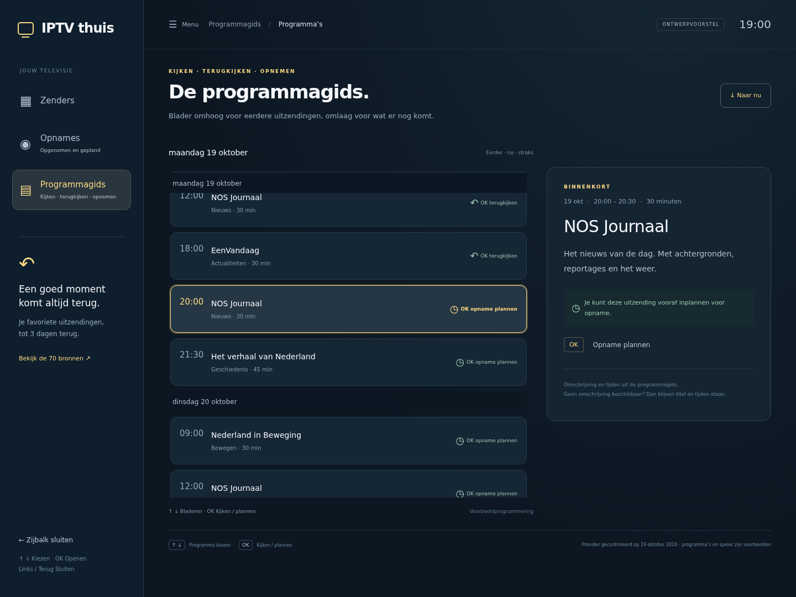
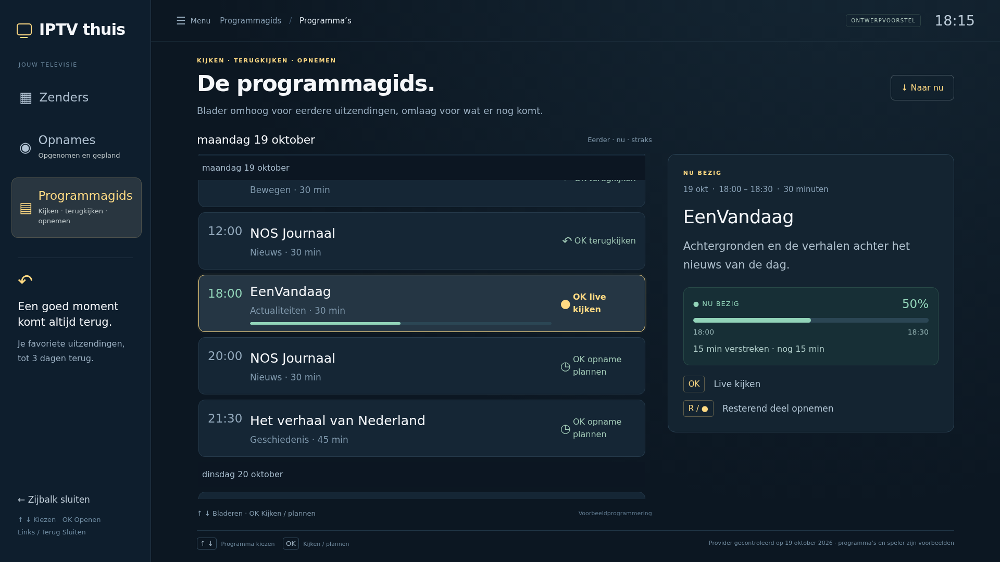

# Catch-up: controle en ontwerp voor de tv

Gecontroleerd op 19 oktober 2026 met het ingestelde provideraccount op de tv-pc. Dit verslag bevat geen inloggegevens, provideradressen of streamadressen.

## Providercontrole

- Het account is actief. De provider vermeldt 2.199 archiefbronnen wereldwijd en 70 Nederlandse bronvarianten, allemaal met 3 dagen archief. HD/FHD en dubbele sportbronnen tellen afzonderlijk mee. De inventaris staat in [catchup-bronnen.json](catchup-bronnen.json).
- Een korte aanvraag van een eerdere NPO 1 HD-uitzending leverde HTTP 206 en 940 bytes MPEG-TS op, met geldige synchronisatiebytes. Daarvoor was een vrije verbinding beschikbaar. De volledige uitzending en andere bronnen zijn niet afzonderlijk afgespeeld.
- De gecontroleerde primaire NPO 1- en Comedy Central-bronnen vermelden catch-up. De primaire bronnen voor NPO 2, NPO 3, RTL 4 en SBS 6 vermelden geen archiefduur, maar Nederlandse HD-varianten daarvan hebben wel 3 dagen archief. Favorieten zijn niet gewijzigd.
- Bij NPO 1 vermeldt de provider archiefduur maar geen positieve `has_archive`-vlaggen in de opgehaalde EPG. De integratie moet broncapaciteit, uitzendtijd en afspeelbaarheid combineren.
- Het account heeft één gelijktijdige verbinding. Een integratie moet een actieve opname respecteren en de live-verbinding vrijgeven voordat een afzonderlijke archiefverbinding wordt gestart.

## Kan het informatieblok echte gegevens tonen?

Ja. De directe provider-EPG voor NPO 1 HD leverde 768 programma’s op, allemaal met een niet-lege omschrijving. In de gecontroleerde `cover`- en `icon`-velden waren geen programma-afbeeldingen aanwezig. Dit zegt nog niets over alle andere zenders of andere afbeeldingsvelden.

De bestaande XMLTV-import in de app bewaart alleen zender-ID, start, einde en titel. Omschrijvingen moeten dus nog worden opgehaald en opgeslagen voor de echte tv-integratie. Een programmabeeld of genre is niet gegarandeerd. Het ontwerp gebruikt daarom een rustig tekstblok met titel, uitzenddatum, tijden, duur en omschrijving. Als een omschrijving ontbreekt, blijft het blok bruikbaar met titel en tijden.

## Eén gids vanuit de geselecteerde zender

Open `/catchup` op het beheeradres. Het ontwerp richt zich op de tv-app en sluit aan bij de donkere stijl en zijbalk. Het menu-item heet **Terugkijken**; daaronder staan eerdere, lopende en toekomstige uitzendingen. De gids wordt geopend vanuit een geselecteerde of gemarkeerde zender. De mockup gebruikt standaard NPO 1; met bijvoorbeeld `?channel=NPO%202` kan die context worden gesimuleerd. Er is geen zenderkeuzelijst of herhaalde zendernaam in de gids.

Er is één doorlopende, scrollbare programmalijst met eerdere, lopende en toekomstige uitzendingen, onderbroken door dagkoppen. Er zijn geen tabs of verplichte dagwissels. De gids opent rond het huidige moment en toont ook komende uitzendingen. Omhoog/omlaag bladert door de lijst, ook over daggrenzen heen. PageUp/PageDown springt vijf regels. Het rechter informatieblok volgt de selectie en bevat geen actieknoppen of grote illustratie.

| Uitzending | Actie op de geselecteerde regel |
| --- | --- |
| Afgelopen | OK: terugkijken vanaf begin |
| Nu bezig | OK: live kijken; R/opnameknop: resterend deel opnemen |
| Toekomst | OK: opname plannen |
| Toekomst, al gepland | OK: opname annuleren |

Opnemen bewaart een eigen bestand op de tv, ook nadat het providerarchief verlopen is. Onder **Opnames** staan **Gepland** en **Opgenomen**. Geplande programma’s krijgen een label en teller; annuleren werkt ook vanuit de opnamelijst. Overlappende opnames geven een conflictmelding.

Alle programmering en afspeelacties in het ontwerp zijn voorbeelden. De tijdelijke planning verdwijnt bij verversen en wijzigt geen echte opnames. De broninventaris is een momentopname. De echte tv-app is nog niet aangepast voor catch-up, omschrijvingen of de nieuwe gids.

## Verificatie

Servertests controleren de beveiligde pagina en assets, inclusief het ontbreken van tabs, een zenderkeuze en de oude actieknop. In Chromium zijn de doorlopende lijst, navigatie over daggrenzen, OK-acties voor terugkijken/plannen/annuleren, de opnameknop voor een lopend programma, de opnamelijst en ontbrekende omschrijvingen gecontroleerd. De eerdere spelercontrole dekt sprongen van 15 seconden, versnelling tot 30 seconden, loslaten en het verdwijnen van de balk na 3 seconden. Dit is nog geen test in de native tv-app of op de echte afstandsbediening.

## Live voortgang en Full HD

Bij een lopende uitzending staat een niet-interactieve voortgangsbalk in de programmaregel en, wanneer geselecteerd, in het informatieblok. De verhouding wordt berekend uit de huidige tijd in Europe/Amsterdam en de begin- en eindtijd van de uitzending. Het blok toont percentage, uitzendtijden, verstreken minuten en resterende minuten. Het wordt iedere 15 seconden bijgewerkt en verdwijnt zodra de uitzending afgelopen is. Dit is geen live-spoelbuffer en geen meting van vertraging in de stream.

De link en het dialoogvenster met de 70 bronnen zijn uit de gids verwijderd. Zenderkeuze hoort bij het hoofdmenu. De gecontroleerde inventaris blijft als documentatie beschikbaar.

De weergave is in Chromium gecontroleerd op een viewport van precies 1920×1080 bij 100% schaal. De pagina blijft 1080 pixels hoog zonder horizontale of verticale pagina-overloop. De programmalijst scrolt binnen 662 pixels; het geteste informatieblok inclusief livebalk past zonder extra scrollen. Titels zijn 25 px, tijden 23 px en omschrijvingen 21 px. Actielabels blijven binnen de kaarten. De screenshot gebruikt voor de controle een vaste tijd van 18:15: de voorbeelduitzending van 18:00–18:30 is dan voor 50% verstreken.

Dit bewijst de schermindeling in de browser, niet de leesbaarheid op een specifieke fysieke televisie vanaf de bank. Het ontwerp is nog niet ingebouwd in de native tv-app.

## Programma-afbeeldingen: bredere controle

Op 19 oktober 2026 zijn de uitgebreide provider-EPG’s gecontroleerd voor 16 Nederlandse zenderbronnen: NPO 1/2/3, RTL 4, SBS 6, ESPN, Ziggo Sport, Eurosport 1, Film1 Premiere, Disney Channel, Nickelodeon, TLC, Comedy Central, Discovery, National Geographic en History. De 9.510 opgehaalde programma’s bevatten geen programma-afbeeldingen, geen gevulde beeldvelden en geen ingebedde afbeeldingen in omschrijvingen. De korte EPG voor vier zenders leverde evenmin beeldvelden op.

Daarnaast zijn de eerste 100.000 programma’s in de XMLTV-feed onderzocht (circa 32 MB). Er waren geen programma-afbeeldingen aanwezig, maar wel 7.293 iconen bij zenderdefinities. Dit zijn zenderlogo’s en geen afbeeldingen van uitzendingen. De XMLTV-controle is een begrensde steekproef, niet de volledige feed.

Conclusie: binnen deze gecontroleerde gegevens biedt de provider geen programmaplaatjes voor het informatieblok. Daarvoor zou een afzonderlijke metadata- of afbeeldingsbron nodig zijn; het ontwerp moet met alleen titel, tijden en omschrijving blijven werken.

## Native implementatie

De eerdere opmerkingen over een uitsluitend browserontwerp zijn achterhaald: de gids is nu ingebouwd in de native Tk-tv-app. Providergegevens zijn gecontroleerd voor NPO 1, NPO 2 en RTL 4; de gids bevat omschrijvingen en beschikbare archiefuitzendingen. De native Full HD-controles zijn geslaagd. Voor een lopend programma neemt één druk op OK het resterende deel op en opent de zender, zonder extra keuzemenu of opnameknop. Zeven native integratietests controleren navigatie, plannen, die OK-actie, voortgang, terugkeren vanuit archiefweergave en opnamebescherming.
